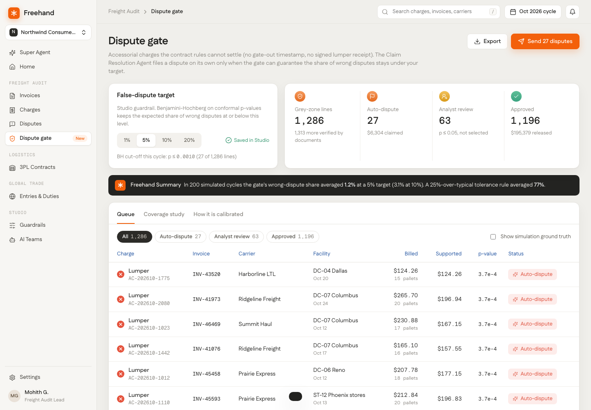

# Dispute gate for Freehand Freight Audit

**Live demo:** https://mohith26.github.io/freehand-dispute-gate/ · unofficial concept, not affiliated with Freehand, synthetic data.

Freehand's Dispute Management Agent files carrier disputes with no analyst queue, and Freehand Studio decides how far that autonomy goes, today through tolerance thresholds ("the dollar or percentage variance that separates a routine match from a flagged exception"). That works when a document settles the question, like a rate card. It breaks down in the grey zone: detention hours with no gate-out timestamp, a lumper fee with no signed receipt, a liftgate at a DC that has dock doors. In those cases a tolerance rule's share of wrong disputes depends on how clean the month happens to be, so nobody can promise carriers or customers a number. **The dispute gate lets the agent file grey-zone disputes on its own only when it can guarantee the expected share of wrong disputes stays under a target you set in Studio (for example 5%), and routes everything else to an analyst or releases it.**



## How it works

1. **Model what a valid charge looks like** from 12 months of settled lines: how often each accessorial type occurs at each facility (shrunk toward the network rate), and, for detention, how many billable hours the facility's *gate-timestamped* trucks that same day support ("peer dwell"; congestion at a DC is shared across trucks on a day, so the trucks that do have timestamps say how long one without them plausibly waited).
2. **Score each grey-zone line** by how surprising it is: `max(0, log(network rate / facility rate)) + S_hours`, where `S_hours` is the empirical upper-tail surprise of billed hours versus peer-supported hours (0 below the median, so under-billing never counts). Unit price is left to the existing contract rule engine.
3. **Conformal p-values** against 5 months of grey-zone lines that settled as valid, within charge type (Mondrian): `p = (1 + #{cal scores >= s}) / (n_type + 1)`. If this cycle's valid lines look like the calibration window, every valid line's p-value is super-uniform, whatever the model gets wrong.
4. **Benjamini-Hochberg** at the Studio target picks the auto-dispute set. Conformal p-values are positively dependent (PRDS), so BH controls the false-dispute rate: `E[wrong / filed] <= target x (valid share)` (Bates, Candès, Lei, Romano, Sesia, *Testing for outliers with conformal p-values*, Annals of Statistics 2023). Lines with p <= 0.05 that BH does not select go to analyst review; the rest are released.

A weak model only costs power (fewer auto-disputes), never the guarantee.

## Results (all from `data/results.json`, produced by `scripts/evaluate.mjs`)

October 2026 simulated cycle: 2,599 accessorial lines, 1,313 settled by documents (rule engine), **1,286 grey-zone lines**, 90 of them overbilled ($15,630).

| Target | Auto-disputes | Wrong | Overbilled $ recovered | Analyst review | 25% tolerance rule (wrong share) |
|---|---|---|---|---|---|
| 1% | 0 | 0 | $0 | 90 | 82% of 466 |
| 5% | 27 | 2 | $5,664 (36%) | 63 | 82% of 466 |
| 10% | 44 | 2 | $8,174 (52%) | 46 | 82% of 466 |
| 20% | 50 | 5 | $8,589 (55%) | 40 | 82% of 466 |

Coverage study, 200 simulated cycles, each with a fresh 5-month calibration window and an overbilling rate of 2-20%:

| | Mean wrong-dispute share |
|---|---|
| Gate, 5% target | **1.2%** |
| Gate, 10% target | 3.1% |
| Per-line test at 5%, no BH | 31% |
| 25%-over-typical tolerance rule | 77% |

The guarantee is in expectation: a single cycle can land above target (this October cycle at 5% filed 27 with 2 wrong, 7.4%). The gate is conservative here because ties and Mondrian strata make p-values coarse; that is visible in the gap between 1.2% and 5%.

## The app

A Freight Audit page in the Freehand shell: the queue (main view), a per-charge drill-down with a "Freehand Summary", validation steps in the style of Freehand's Rate Validation table and the calibration histogram, the coverage study, and a method page. Actions: set and save the Studio target, override a decision (D / R / A), send all auto-disputes to the Claim Resolution Agent (with undo), export CSV or JSON. Deep links (`#/queue?alpha=0.1&f=dispute&line=AC-202610-0030`), state in localStorage, keyboard (`/`, `j`/`k`, `Esc`, `e`), loading/empty/error states. Toggle "Show simulation ground truth" to see which lines were actually overbilled.

## Data

Synthetic and seeded (`scripts/generate.mjs`, seed 20261101): one shipper, 8 carriers, 14 receiving facilities, 2,400 shipments a month for 18 months. Fee levels are drawn inside ranges published in public accessorial guides: detention $50-100/h after 2 free hours billed in 15-minute steps, liftgate $50-150, lumper $100-400, layover $150-300/day, TONU $150-350, redelivery $75-150, driver assist $50-150 (Warp freight glossary; USI accessorial guide; Broker Pro Academy 2026; carrier tariffs such as States Logistics' 2 free hours and $26.25 per 15 minutes). Overbilling kinds: padded detention hours, unearned detention on fast days, liftgate at dock-equipped DCs, lumper at DCs that unload with their own crew, driver assist at crewed DCs. Carrier and facility names are fictional.

## Honest limitations

- Synthetic data. The peer-dwell signal is only as strong as the real day-level correlation of dwell at a facility; I assumed a congestion effect (log-sd 0.45) larger than truck-level noise (0.2).
- Calibration needs lines that *settled as valid*. If settlement itself is selective (only easy lines get confirmed), exchangeability breaks and the guarantee weakens. A real deployment should calibrate on a random audit sample of grey-zone lines.
- New carriers, new contracts or a facility process change between calibration and the cycle break exchangeability too; the calibration window should roll and be reset on known changes.
- Recall is modest at strict targets (28% of overbilled lines auto-disputed at 5% in October). A liftgate at a DC with dock doors happens legitimately often enough that the gate sends it to review rather than disputing; that is the guarantee doing its job.
- Unit price and duplicates are out of scope on purpose: the contract rule engine settles them deterministically.

## Prior art and what is new

Conformal outlier detection with BH (Bates et al., 2023) and Mondrian conformal prediction (Vovk et al.) are established. Freight audit vendors (Freehand, Loop, Nestack, Last Rev) use tolerance thresholds or per-finding confidence scores to gate disputes; I did not find one that controls the false-dispute rate of autonomous filing, or that uses same-day gate-timestamped peers to check detention on trucks without timestamps. Pages checked: freehand.ai freight audit, Dispute Management Agent, Studio and autonomous-exception articles; loop.com freight audit; nestack.com dispute agent; lastrev.com freight bill audit.

## Run

```
node scripts/generate.mjs   # data/world.json
node scripts/evaluate.mjs   # data/results.json (coverage study, ~2 s)
node --test test/*.test.mjs # 14 tests
python3 -m http.server      # open http://localhost:8000
```

No build step; the page loads Fustat/Geist Mono and Lucide from CDNs. Core logic is in `src/gate.js` and runs unchanged in the browser and in Node.
